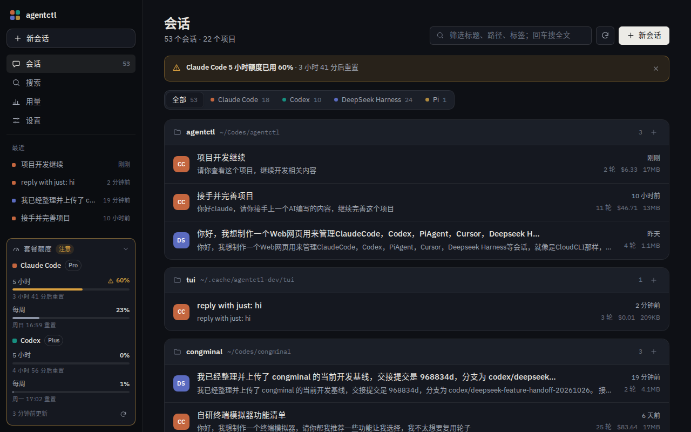
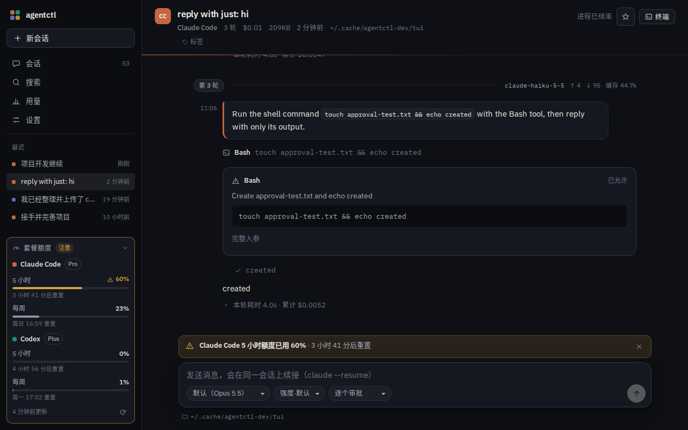
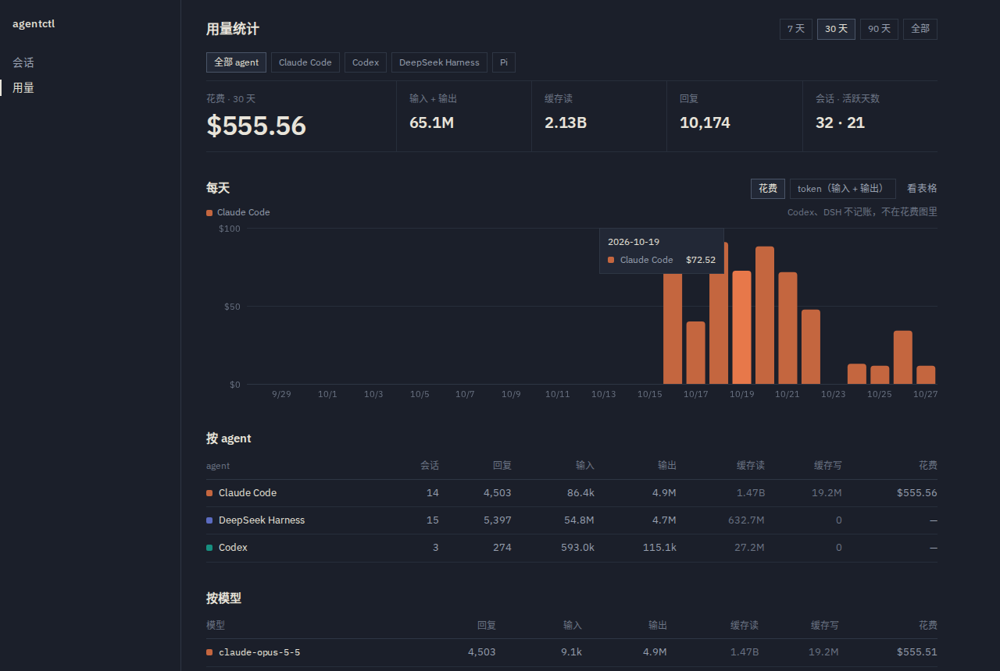
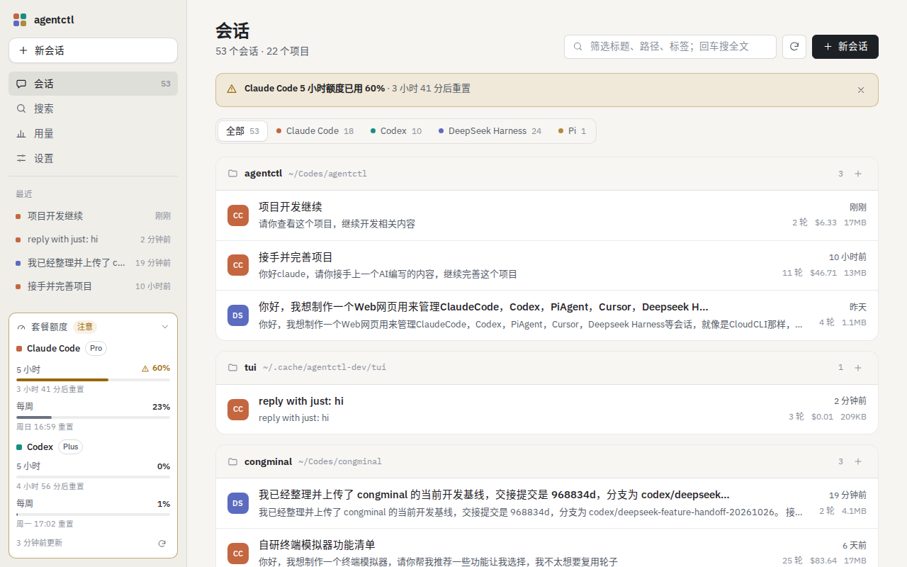
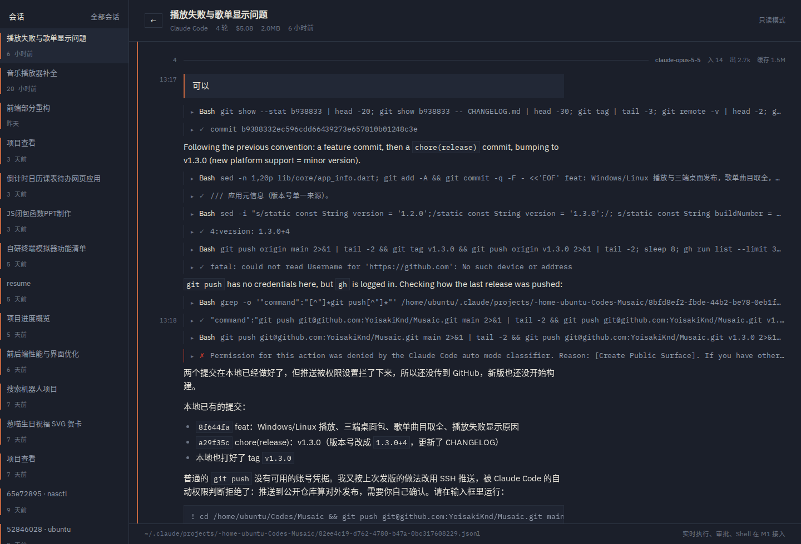
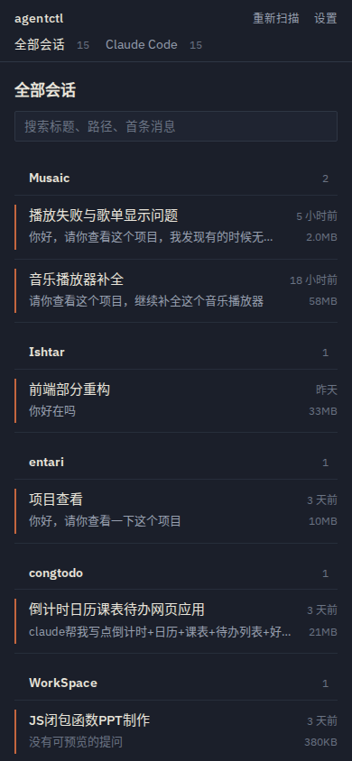
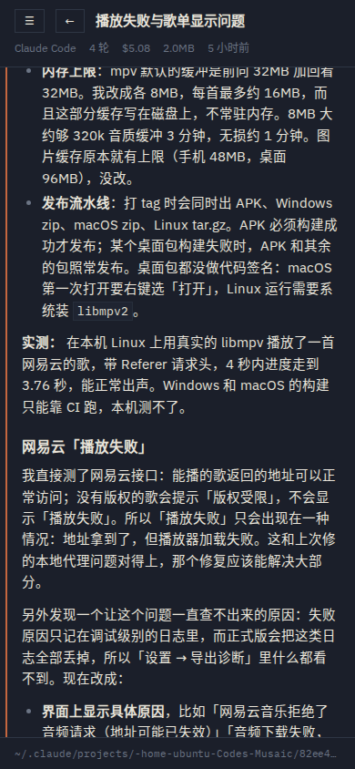
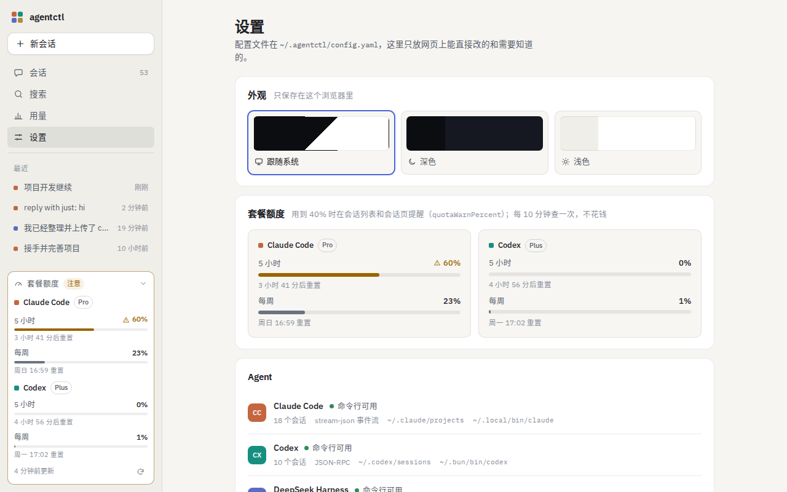

# agentctl

把本机所有编码 agent 的会话收进一个网页里看、接着聊：Claude Code、Codex、DSH、Pi、Cursor。
**不改动 agent 自己的文件**——回放只读文件，实时运行由 agent 自己写盘；索引库可以随时删掉重建。



## 现在能做什么

- **在网页里跑 Claude Code、Codex、DeepSeek Harness**：新建会话或在任意历史会话上继续对话；流式输出、工具调用审批（允许 / 本会话内都允许 / 拒绝）、打断、结束进程。会话照常写进 `~/.claude/projects`，终端里 `claude --resume` 接得上。
- **自动刷新**：会话页每 2 秒增量追文件尾（只读新增的字节），终端里正在跑的会话也会实时出现；读者往上翻时不打扰，底部亮「有新内容」。看板和侧栏 15 秒刷新一次。
- **模型列表来自 CLI**：和终端里 `/model` 看到的一致（别名 + 指定版本 + 推理强度）；进程运行中也能直接切换模型。
- **全文搜索**：一次扫所有 agent 的全部会话（不建索引），只匹配人能读到的内容（提问、回复、思考、命令、输出、diff），点结果直接跳到会话里的那一条并高亮。本机约 600MB 会话一次约 2.5 秒。
- **套餐额度与刷新提醒**：Claude Code、Codex 的 5 小时 / 每周额度常驻侧栏（CLI 自己查，不花钱），还能添加任意 JSON 接口或 DeepSeek 余额作为订阅源。额度刷新、快用完、余额不足时提醒：网页右下角，以及 ntfy / Bark / Telegram / Webhook / 浏览器通知。
- **用量统计**：每个 agent 每天花了多少钱、多少 token，按模型、按会话拆开看。Claude 的花费以它自己的记账为准，按回复摊到各天；Codex、DSH 只有 token。
- **置顶、标签、改名**：给会话起自己的标题、打标签、置顶，看板按标签筛选。只存在 agentctl 的索引库里，不改 agent 的文件。
- **改文件看 diff**：Claude 的 Edit / MultiEdit / Write、Codex 的 apply_patch / FileChange 都显示为可展开的着色 diff。
- **会话看板**：按项目分组，显示标题、首条提问、轮数、花费、体积、最近活动时间；搜索标题/路径/首条消息；侧脊按 agent 过滤。
- **时间线回放**：一轮一轮往下读，人类提问、助手文本（Markdown）、thinking、工具调用与结果、后台任务通知、每轮耗时与 token 用量、本轮模型。
- **大文件不卡**：175MB / 13839 行的会话首屏 **约 20ms**（尾部优先按字节窗口读，向前翻页带游标）。
- **手机可用**：侧栏收成抽屉，单列时间线，终端带快捷键条和整行输入框，实测 390×844。
- **深色 / 浅色主题**：默认跟随系统，设置里可固定。
- **远程可用**：默认只听 `127.0.0.1`；`--host 0.0.0.0` 必须先设密码，否则拒绝启动。





| 浅色主题 | 时间线 |
|---|---|
|  |  |

| 手机看板 | 手机时间线 | 设置 |
|---|---|---|
|  |  |  |

## 快速开始

```bash
pnpm install
pnpm build                # 构建前端到 apps/web/dist
pnpm start                # http://127.0.0.1:8787
```

开发时开两个终端：`pnpm dev:server`（tsx watch）+ `pnpm dev:web`（vite，5173 端口，把 `/api` 代理到 8787）。

其他命令：

```bash
pnpm smoke                # 解析器冒烟：发现耗时、最大会话首屏、向前翻页、refine
pnpm smoke:live           # 实时运行冒烟：真的跑一次 claude（haiku，约 $0.003）走完审批与续问
pnpm smoke:codex          # Codex 解析冒烟：发现、每个会话首屏、uid 唯一性、轮次
pnpm smoke:dsh            # DSH 解析冒烟（zstd 多帧解压 + 解析）
pnpm smoke:pi             # Pi 解析冒烟（会话树取当前分支）
pnpm smoke:usage          # 用量冒烟：Claude 每个会话按天合计 vs cost-state 记账
pnpm typecheck            # 四个包的 tsc --noEmit
pnpm status               # 看配置、监听地址、是否已设密码
```

## 部署到服务器（常驻运行）

需要：Linux + systemd、Node ≥ 22.13、pnpm，以及要管理的 agent 命令行（如 `claude`）已在**同一用户**下登录可用。

```bash
git clone https://github.com/YoisakiKnd/agentctl.git ~/agentctl && cd ~/agentctl
pnpm install
pnpm passwd                                      # 远程访问必须先设密码
# 编辑 ~/.agentctl/config.yaml：host 写 Tailscale 地址或 0.0.0.0，port 默认 8787
pnpm service:install                             # 构建前端 + 装成 systemd 用户服务并启动
```

- 服务跑在当前用户下（不需要 root），这样才能读到 `~/.claude` 等目录、调用 `claude`。
- 开机自启需要 linger：`sudo loginctl enable-linger $USER`（脚本会提示）。
- 更新代码后重新运行 `pnpm service:install` 即可；日志 `journalctl --user -u agentctl -f`；卸载 `pnpm service:uninstall`。
- 重启服务会结束网页里起的 agent 进程，会话已落盘，下次发消息自动续接。

配置项（`~/.agentctl/config.yaml`）：

| 键 | 默认 | 说明 |
|---|---|---|
| `host` / `port` | `127.0.0.1` / `8787` | 非回环地址必须先设密码 |
| `password` | — | `pnpm passwd` 写入的 scrypt 哈希 |
| `allowedRoots` | `[]` | 网页端可作为工作目录的路径白名单，空表示不限 |
| `allowBypassPermissions` | `true` | 设为 `false` 后网页端不提供「跳过所有权限」 |
| `quotaWarnPercent` | `80` | 套餐额度用到这个百分比时在网页上提醒 |
| `agents.<id>.enabled` | `true` | 关掉某个 agent（`claude` / `codex` / `dsh` / `pi`） |
| `cookieSecure` | `false` | 放在 HTTPS 反代后面时打开 |
| `tls.cert` / `tls.key` | — | 直接以 HTTPS 提供服务 |

## 远程 / 手机访问

```bash
pnpm passwd                        # 设置访问密码（scrypt 哈希写入 ~/.agentctl/config.yaml）
AGENTCTL_HOST=0.0.0.0 pnpm start   # 绑定所有网卡；启动时会打印局域网地址
```

想长期生效就把 `host: 0.0.0.0` 写进 `~/.agentctl/config.yaml`，之后 `pnpm start` 即可。

### Tailscale（推荐：不用开公网端口）

只绑 Tailscale 地址，公网和局域网都碰不到，链路本身已经由 WireGuard 加密：

```bash
pnpm passwd                                   # 先设密码
# ~/.agentctl/config.yaml 里写 host: 100.x.y.z（值取 `tailscale ip -4`）
pnpm start                                    # 打开 http://100.x.y.z:8787
```

临时覆盖用 `AGENTCTL_HOST=100.x.y.z pnpm start`。注意绑具体网卡后，`127.0.0.1` 也一并不可用，
本机同样走 Tailscale 地址访问。

启动时会把局域网地址打印出来，手机同网段直接打开即可。要点：

- 没有密码时**拒绝**绑定非回环地址。现在网页能驱动 agent 执行命令，暴露出去等于远程 shell。
- 所有写接口校验 `Origin` 必须同源，防止别的网页借你的 cookie 发请求。
- 明文 HTTP 传密码等于没设密码：跨公网请套 HTTPS 反代，或在 `~/.agentctl/config.yaml` 里写 `tls.cert` / `tls.key`，或用 Tailscale 之类的隧道。
- 登录票据是 HttpOnly + SameSite=Lax 的 cookie，30 天；同一 IP 5 分钟内错 5 次锁一会儿。

## 实时运行怎么工作

```
浏览器 ──POST /api/runs、/send、/approve──▶ server ──stdin(stream-json)──▶ claude -p
       ◀────────── SSE /api/runs/:id/stream ◀──── stdout(stream-json) ◀──┘
```

- 一个会话一个常驻进程：`claude -p --input-format stream-json --output-format stream-json --permission-prompt-tool stdio`，多轮复用；空闲 30 分钟自动退出，下次发消息自动 `--resume`。
- 工具审批走与官方 Agent SDK 相同的 stdio control 协议。「本会话内都允许」只作用于当前进程，**不会**替你把规则写进任何 settings 文件。
- 实时事件与磁盘回放同构，按行 `uuid` 去重：刷新页面、换设备打开都能接上同一个运行，不重不漏。
- 权限模式：逐个审批 / 自动接受编辑 / Auto 模式 / 只做规划 / 跳过所有权限（需二次确认）；进程运行中可以直接切换。进程总是带 `--allow-dangerously-skip-permissions` 启动——它只是"允许之后切到 bypass"，默认行为不变；`allowBypassPermissions: false` 时不带。
- `AskUserQuestion` 在网页里是一张问答表单（单选 / 多选 / 自填）。
- **终端（Shell 模式）**：会话页右上角「终端」打开真正的 `claude --resume <会话>`（斜杠命令、/model 菜单等 TUI 功能都在），也可以切到普通 shell。终端进程在服务端常驻，刷新、手机切后台后自动重连并回放；手机上有 Esc / Tab / ^C / 方向键条。同一会话的终端和输入框进程互斥。
- 已知限制：打断时已生成的半段文字不保留。

## Codex 怎么接的

- **回放**：rollout 有两代格式，逐行看有没有 `ordinal` 区分。新版取 `item_completed`（真实执行的命令、带统一 diff 的文件改动、网页搜索），旧版取 `response_item` + `event_msg`。标题来自 `session_index.jsonl`，Guardian 审查这类子代理会话在列表里标成「子代理」。
- **轮次**：Codex 的行上没有轮号，只有每轮一条 `task_started`；按字节偏移建索引并增量更新，任意窗口都能定位轮次。
- **实时**：一个会话一个 `codex app-server` 进程，`thread/start` / `thread/resume` + 每条消息一个 `turn/start`。实时 item 归一成文件格式后走同一个解析器，uid 与磁盘一致。
- **权限模式**映射为 Codex 的审批策略 + 沙箱：逐个审批 = untrusted + workspace-write，Auto = on-request + workspace-write，只读 = on-request + read-only，跳过所有权限 = never + danger-full-access；运行中切换从下一轮生效。

## DSH 怎么接的

- **zstd 多帧**：DSH 每追加一批记录写一帧。Node 自带的 zstd 只解第一帧，所以 `packages/core/src/zstd.ts` 按 RFC 8878 自己走帧头和块头，把每一帧切出来单独解压，并记下"已完整解出的压缩字节数"——文件追加后只解新帧，尾部写了一半的帧下次再读。31 个文件与系统 `zstd -dc` 逐字节一致。
- **内存**：全部会话解压后约 150MB，所以列表摘要只保留增量状态、不留原文；打开的会话进 128MB 的 LRU。
- **回放**：每条记录自带绝对轮号和单调 `seq`（直接当 uid）；`user/message` 只有 `source.kind = user` 才是人说的话，其余注入上下文（记忆、任务提醒、运行时快照……）不上时间线，后台任务结果、子代理来信等渲染成提示。
- **实时**：`--profile sdk` 只能新建会话、没有取消，所以走 `--profile acp`（`session/new`、`session/resume`、`session/cancel`、`session/set_config_option`）。ACP 推送的不是会话文件里的记录，只用来做草稿、审批和状态；时间线全部来自文件增量追尾（运行中每秒一次），实时与回放天然一致。
- 模型列表由 ACP 在建立会话后给出（不同于 web 配置里的自定义 provider，acp 配置用的是 deepseek-official）；DSH 的 ACP 没有暴露权限模式，网页上不提供切换。

## 隐私边界

- 回放只读 agent 的会话文件（`~/.claude/projects`、`~/.codex/sessions`、`~/.dsh/sessions`、`~/.pi/agent/sessions`），不写、不移动、不删除；实时运行时由 agent 自己写盘。
- 不解析任何凭证文件（`~/.claude/settings.json`、`~/.codex/auth.json` 等），只探测存在性。
- `~/.agentctl/index.db` 是纯索引（标题、轮数、花费、字节偏移），删了下次启动自动重建。
- 图片只记 `[图片 12.3KB]` 这样的占位，不把 base64 塞进页面。

## 仓库结构

```
packages/core              统一事件模型、按字节窗口的读行工具、zstd 多帧解压、stdio JSON-RPC、AgentAdapter 接口
packages/adapter-claude    Claude Code 适配器：discover / replay / refine（index.ts）、行解析（parse.ts）、实时运行（live.ts）
packages/adapter-codex     Codex 适配器：同上结构；实时运行走 codex app-server
packages/adapter-dsh       DeepSeek Harness 适配器：zstd 增量解压回放；实时运行走 dsh --profile acp
packages/adapter-pi        Pi 适配器：只读回放（会话树取当前分支）
apps/server                Fastify：配置、鉴权、SQLite 索引、扫描缓存、运行进程表（runs.ts）、REST + SSE、静态托管
apps/web                   React + Vite：看板、时间线、composer、审批、新会话、设置、登录
docs/PLAN.md               技术方案（勘察数据、架构、里程碑、风险）
```

## 接口

| 方法 | 路径 | 说明 |
|---|---|---|
| GET | `/api/health` | 版本、是否需要登录、是否远程模式 |
| GET | `/api/auth/me` · POST `/api/auth/login` · POST `/api/auth/logout` | 登录态 |
| GET | `/api/agents` | 各 agent 的会话数、总花费、总字节、二进制可用性 |
| GET | `/api/sessions?agent=&q=` | 会话列表 |
| GET | `/api/sessions/:id` | 单个会话摘要 + 当前运行（如有）+ 是否支持实时运行 |
| GET | `/api/sessions/:id/events?before=&maxBytes=` | 时间线窗口（`before` 是字节偏移，向前翻页） |
| GET | `/api/sessions/:id/events?after=` | 增量：从上次窗口末尾读到文件末尾（文件没变时只是一次 stat） |
| GET | `/api/sessions/:id/events?through=` | 跳转：窗口以这个偏移所在的行结尾 |
| GET | `/api/search?q=&agent=` | 全文搜索；最多 200 处、单会话 20 处、15 秒上限，超出时 `truncated: true` |
| GET | `/api/quota?refresh=` | 套餐额度（Claude、Codex 的 5 小时 / 每周窗口）；`refresh=1` 立即去问 CLI |
| POST | `/api/quota/settings` | 提醒设置 `{resetMinUsed?, disabled?}` |
| POST · DELETE | `/api/quota/sources[/:id]` | 自定义订阅源增改删；`POST /api/quota/sources/test` 按配置试拉一次 |
| GET · POST · DELETE | `/api/notify/channels[/:id]` | 提醒渠道；`POST /api/notify/channels/:id/test` 发测试消息 |
| GET | `/api/notifications?after=` | 提醒记录（网页据此弹提示） |
| GET | `/api/usage?days=&agent=` | 用量：按天 × agent、按 agent、按模型、前 20 个会话；`days=0` 为全部 |
| POST | `/api/sessions/:id/annotation` | 注解 `{pinned?, tags?, title?}`，缺省字段不改，`title: ""` 恢复原标题 |
| GET | `/api/tags` | 所有标签及使用次数 |
| GET | `/api/agents/:id/models` | CLI 当前可用的模型（`initialize` 握手拿到，不花钱，缓存 10 分钟） |
| POST | `/api/runs/:id/model` | 运行中切换模型 `{model}` |
| POST | `/api/runs/:id/permission-mode` | 运行中切换权限模式 `{mode}` |
| POST | `/api/runs/:id/effort` | 运行中切换推理强度 `{effort}`（DSH） |
| POST | `/api/sessions/:id/send` | 往会话发消息：有活进程就写 stdin，否则 `--resume` 起一个；没带的运行选项沿用会话上次的 |
| POST | `/api/runs` | 新建会话 `{cwd, prompt, model?, permissionMode?, createDir?}`，等 agent 分配 id 后返回；目录不存在时返回 409，带 `createDir: true` 重发才新建 |
| GET | `/api/fs/check?path=` | 检查工作目录：存在？不存在的话能不能新建 |
| POST | `/api/sessions/:id/prefs` | 存这个会话的运行选项（下拉框一改就存） |
| GET · POST | `/api/run-defaults[/:agent]` | 每个 agent 上次用的运行选项（新建会话页的默认值） |
| GET | `/api/runs` | 运行中的进程 |
| WS | `/api/sessions/:id/shell?kind=agent\|shell` | 终端：`{type:input\|resize\|kill}` 上行，`{type:ready\|output\|exit\|error\|ping}` 下行；接上时先发屏幕快照 |
| GET | `/api/runs/:id/stream` | SSE：先回放该运行的全部事件，再推实时 |
| POST | `/api/runs/:id/approve` · `/interrupt` · `/stop` | 审批 `{requestId, decision, answers?}` / 打断本轮 / 结束进程 |

## 适配器进度

| Agent | 只读回放 | 实时运行 |
|---|---|---|
| Claude Code | ✅ 已接入（`~/.claude/projects/*.jsonl`） | ✅ stream-json + 审批桥 + 问答 + 打断 + Shell 模式 |
| Codex | ✅ 已接入（`~/.codex/sessions/**/rollout-*.jsonl`，新旧两代格式） | ✅ `codex app-server` JSON-RPC：审批、问答、打断、运行中切模型 / 权限 + Shell 模式 |
| DSH | ✅ 已接入（`~/.dsh/sessions/**/session.v4.jsonl.zstd`，增量解压） | ✅ `dsh --profile acp`：新建 / 续接、打断、运行中切模型与推理强度、三档权限预设（网页终端只提供普通 shell；Agent 预设 ACP 不支持） |
| Pi | ✅ 已接入（`~/.pi/agent/sessions`，会话树取当前分支，含花费） | 本机未装 `pi` 命令行，只读 |
| Cursor | 本机未安装、无会话数据 | — |

新增一个 agent = 实现一个 `AgentAdapter`（`discover` / `replay` / 可选 `refine`、`run`），注册到 `apps/server/src/index.ts` 的 adapters 数组即可。

细节、取舍和里程碑见 [docs/PLAN.md](docs/PLAN.md)。

## 许可

[MIT](LICENSE)
